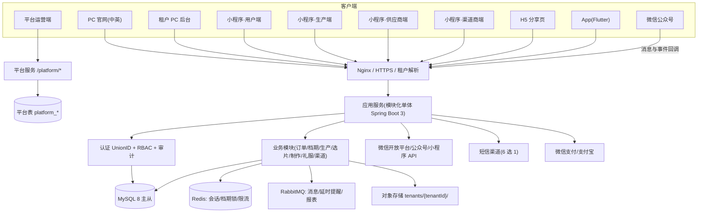
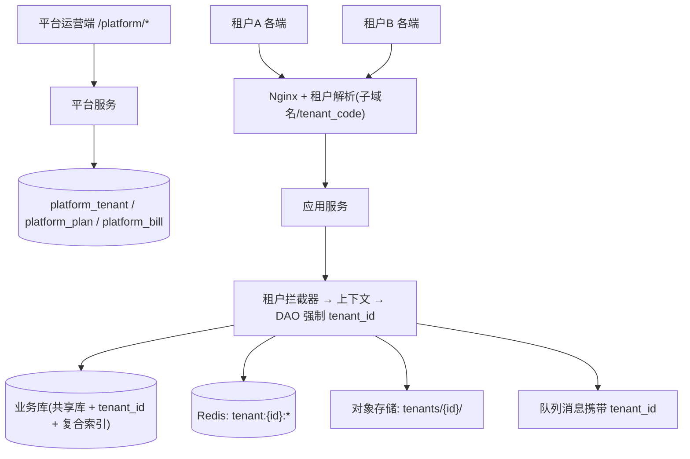

# 婚庆摄影数字化多端 SaaS 平台 PRD

> 品牌背景：区域连锁婚纱摄影与婚礼影像品牌（总部 + 3~5 家直营门店/影棚 + 外景基地），主打婚纱照套系、婚礼当日跟拍、婚礼跟妆、孕妈/儿童/全家福、礼服租赁、旅拍、相册相框制作。获客渠道：门店自然到店、小程序与公众号线上留资、酒店/婚庆策划/礼服馆等异业渠道转介绍、老客转介绍。经营痛点：档期靠微信群+Excel 排，摄影师/化妆师/影棚超卖与撞档频发；选片加片靠口头议价，收入流失且纠纷多；客片散落在个人电脑与网盘，交付慢、丢失无法追溯；多门店价格与提成口径不一致；异业渠道佣金结算靠手工对账。
> 项目名称：婚礼影像数字化多端 SaaS 平台（平台运营端 + 租户后台 + 多业务端）
> 产品矩阵：平台运营端（SaaS 控制台） + PC 品牌官网（中英双语 SEO） + PC 租户后台 + 微信公众号（服务号） + 微信小程序·用户端 + H5 分享页 + 小程序·摄影师/化妆师生产端 + 小程序·供应商端 + 小程序·渠道商端 + Flutter App（会员端，iOS/Android）
> 上线模式：一次性完整上线，不分一期二期
> 存储方案：抽象对象存储驱动层（本地磁盘 / AWS S3 / 阿里云 OSS / 腾讯云 COS / MinIO），后台可视化切换，密钥加密存储；客片按"原片 / 精修成片 / 相册印刷文件"三类分目录归档，路径统一带租户前缀
> 架构说明：前后端分离，一后端多前端壳。保留 RBAC 多角色权限（平台/租户两级超管）、全操作审计日志、公众号/小程序/H5/App UnionID 会员互通、多语言 i18n、菜单可视化编辑、系统参数可视化配置、富文本 CMS、消息配置（4 通道 + 6 短信渠道）、SSO 单点登录、多租户 SaaS 底盘（共享库 + tenant_id）。**本平台一律为多租户 SaaS，不产单商户自用版本。**

## 核心约束（婚庆摄影行业合规与业务红线，代码强制约束）

1. **肖像权**：客片展示必须取得书面《肖像使用授权书》，授权状态在订单与客片库双记录；未授权客片在前台 CMS、案例库、公众号素材、小程序样片中一律不可选、不可发布；授权可撤回，撤回后 24 小时内自动下架。
2. **预付费**：婚纱摄影为预付费服务，定金锁档期、尾款按"拍摄当日 / 取件前"节点收取（节点与比例后台可配）；储值卡与预付卡遵守单用途预付卡相关规定，充值限额、退卡规则、有效期均后台可配并在前台明示。
3. **档期唯一性**：摄影师、化妆师、影棚/场景、跟拍机位在同一时间窗内唯一占用，超卖与撞档必须在服务端拦截（前端灰显仅为提示）。
4. **客片隐私**：原片与精修成片属客户个人隐私，仅订单关联人与授权员工可访问；后台预览强制水印（订单号 + 员工工号）；下载与批量导出全量审计；交付后原片保留期后台可配（默认 90 天），到期提醒并可延期一次。
5. **二次消费明码标价**：加片、加急、加册、换框、礼服升级等全部为系统内配置项，选片环节须生成《加购确认单》并由客户线上签字，禁止选片师线下口头加价。
6. **未成年人**：儿童/孕妈/全家福类订单，须监护人签署授权与肖像使用同意，订单上记录监护人关系。
7. **客片资产安全**：对象存储开启版本保护与回收站策略，数据库每日备份，客片目录按月归档并对账（文件数 + 容量），丢失可追溯。
8. **广告合规**：禁止"最美""第一""永久保存"等绝对化与承诺性表述，套系页标明包含项目、拍摄时长、服装套数、成片张数、交付周期、加购单价。
9. **提成与佣金**：门市提成、摄影师/化妆师计件、修片计件、渠道佣金比例全部后台可配，规则变更留痕，历史订单按成交时规则快照计算，禁止改规则后倒算历史。
10. **多语言**：平台内置中文（简体）+ English 双语，官网与旅拍页面对海外客户开放；内容按语言独立录入，未翻译字段前台回落默认语言并标注。

## 一、架构设计（标准档）

### 1.1 需求摘要

#### 1.1.1 功能需求（按端）

| 端 | 核心功能 | 依赖模块 |
|---|---|---|
| 平台运营端 | 租户开通/停用/续期、套餐与配额、账单计费、平台公告、平台审计、平台账号与角色 | 多租户底盘、RBAC、审计 |
| PC 品牌官网 | 品牌展示、套系与样片、客片案例、旅拍线路、资讯、在线留资、门店导航、SEO（中英） | CMS、i18n、留资 CRM |
| PC 租户后台 | 门店影棚、套系商品、档期日历、订单收款、拍摄生产、选片精修、相册制作、礼服租赁、会员 CRM、渠道分销、供应商、员工提成、CMS、公众号管理、消息、SSO、菜单可视化、统计、审计 | 必带模块 1–14 |
| 微信公众号（服务号） | 菜单、自动回复、模板消息、粉丝标签、素材草稿、图文发表 | 公众号管理 11 子页、消息配置 |
| 小程序·用户端 | 套系浏览、样片、档期查询与预约、定金支付、订单进度、选片、精修确认、加购、优惠券、会员 | UnionID、支付、档期、订单 |
| H5 分享页 | 套系/样片分享落地、活动报名、支付回跳、婚礼当日直播相册入口 | UnionID、CMS |
| 小程序·生产端 | 今日任务、档期排班、现场打卡、拍摄清单、客片上传、修片任务、返工、计件业绩 | 拍摄生产、选片精修 |
| 小程序·供应商端 | 制作单接单、进度回传、发货、对账结算、资质上传 | 相册制作、供应商协同 |
| 小程序·渠道商端 | 报单、客户归属、佣金明细、额度、专属价、下级管理 | 渠道分销 |
| App（Flutter） | 会员中心、档期预约、订单进度、选片、消息推送、电子合同 | UnionID、支付、推送 |

#### 1.1.2 非功能需求（NFR）

| 维度 | 指标 |
|---|---|
| 并发 | 峰值 300 QPS（促销日档期查询与下单合计），下单接口独立 50 QPS |
| 响应 | 官网首屏 < 2s；后台列表接口 P95 < 500ms；客片列表首屏 < 1.5s（缩略图走 CDN/签名 URL） |
| 可用性 | 99.5%；单机部署需在部署方案中说明单点风险与恢复演练 |
| 数据量 | 3 年：单租户会员 5 万、订单 8 万、客片文件 60 万张 / 8 TB；平台租户 ≤ 50 |
| 安全 | 全站 HTTPS；密钥 AES 加密；审计留存 ≥ 180 天；客片访问签名 URL 有效期 ≤ 30 分钟 |
| 合规 | ICP 备案、营业执照与摄影服务资质公示、隐私政策与用户协议、单用途预付卡规则公示、肖像授权书留档 |
| 可维护 | 金额、比例、提成、佣金、超时、保留期等参数 100% 后台可配，禁止写死 |

### 1.2 系统架构图

#### 1.2.1 一后端多前端壳



#### 1.2.2 多租户链路



### 1.3 架构决策记录（ADR）

#### ADR-001：模块化单体 + 一后端多前端壳

- **状态**：已接受
- **背景**：9 个前端入口、峰值 300 QPS、单团队维护、租户规模 ≤ 50，业务耦合度高（订单-档期-生产-选片-制作强关联）。
- **决策**：后端采用 Spring Boot 3 模块化单体（按业务域分包 + 独立 Service 边界），所有端共用一套 API、权限、UnionID、存储；前端仅做壳与角色差异。
- **备选与取舍**：
  - A 微服务拆分：独立扩容与团队并行能力强，但 9 端共用主数据，分布式事务、链路追踪、运维成本高，当前团队规模不匹配。
  - B 每端独立后端：迭代快但会员与订单会分裂，直接违背 UnionID 互通口径。
- **后果**：部署简单、事务一致；需用包边界与代码评审约束模块腐化；压测在应用层横向扩容即可。

#### ADR-002：租户隔离起步用共享库 + tenant_id

- **状态**：已接受
- **背景**：租户数预期 ≤ 50，单租户数据量中等（8 万订单、8 TB 客片在对象存储而非库内），需要跨租户汇总与低成本开通。
- **决策**：共享库 + 全表 `tenant_id` + 复合索引 + 拦截器强制注入；对象存储与缓存按租户前缀隔离；该方案单列为本项目隔离基线。
- **备选与取舍**：
  - 独立 schema：隔离更强，但 50 个 schema 的 DDL 版本管理与连接池成本高。
  - 独立库：最强隔离，但开通成本高、跨租户报表需汇总层。
- **后果**：开通 ≤ 3 分钟；风险集中在"漏加 tenant_id"，用拦截器 + 静态扫描 + 越权用例进 CI 兜住；预留 TenantDataSource 抽象，租户 > 50 或单租户 > 500 万行时评估升级 schema。

#### ADR-003：对象存储抽象 + 客片三级目录与签名访问

- **状态**：已接受
- **背景**：客片是核心资产（单租户 8 TB、60 万文件），来源方对存储有偏好（自建 MinIO / 云 OSS / COS / S3），且客片含肖像隐私。
- **决策**：统一 StorageProvider 接口（5 驱动可切，密钥加密），路径固定 `tenants/{id}/orders/{orderNo}/{raw|retouched|print}/`；私有桶 + 签名 URL（≤30 分钟）+ 预览水印；按月对账文件数。
- **备选与取舍**：
  - 只用云 OSS：省运维，但中小客户不愿承担流量成本。
  - 全部本地磁盘：成本低，但无版本保护、扩容与异地备份困难。
- **后果**：切换驱动时历史文件仍由原驱动读取（页面二次确认），新上传走新驱动；必须实现连接测试后才允许保存。

### 1.4 技术选型对比

| 维度 | 方案 A（采用） | 方案 B | 方案 C | 结论与理由 |
|---|---|---|---|---|
| 后端 | Java 17 + Spring Boot 3 + MyBatis-Plus | PHP + Laravel | Python + FastAPI | 订单/档期强事务、多月租户隔离与审计要求高，选 A；B 适合小团队快速上线但长期演进弱；C 适合算法侧（修片 AI）但生态与本团队不符 |
| 数据库 | MySQL 8（utf8mb4，主从） | PostgreSQL | — | 事务与生态成熟、运维人才多；本期无 GIS/复杂分析诉求，不选 PG |
| 后台前端 | Vue3 + Vite + TS + Element Plus（vue-pure-admin） | React + AntD | — | 团队既有 Vue 资产，模板成熟可直接套用 |
| 小程序 | 微信原生（同仓多工程共用组件与请求层） | uni-app | Taro | 需 4 个小程序且各有差异化页面，原生性能与调试链路更稳；共用 `components/request` 层避免重复代码 |
| App | Flutter（Riverpod + Dio + Hive） | React Native | — | 客户指定要 App，Flutter 双端一致性与团队可控性更好 |
| 部署 | Docker Compose（单机/双机） | K8s | 宝塔面板 | 租户 ≤ 50、无弹性伸缩硬需求，Compose 足够；K8s 运维成本过高 |

### 1.5 风险与缓解

| 风险 | 影响 | 概率 | 缓解措施 |
|---|---|---|---|
| 档期超卖/撞档 | 客户投诉、退单赔付 | 高 | 服务端时段唯一索引 + Redis 分布式锁 + 事务内二次校验；前端灰显仅作提示 |
| 客片丢失或误删 | 不可交付、法律纠纷 | 中 | 对象存储版本保护 + 回收站 30 天 + 月度文件数对账 + 每日库备份 |
| 未获授权的客片被用于宣传 | 侵权赔偿、平台下架 | 中 | 授权状态作为客片发布前置校验，撤回即自动下架 |
| 跨租户越权（漏加 tenant_id） | 数据串号、合规事故 | 中 | 拦截器强制注入 + 代码扫描规则 + 越权用例进回归 |
| 公众号 appId 被现网系统接管 | 回调互踢、菜单互盖、token 配额互耗 | 中 | 接号前查服务器 URL / 粉丝 / 菜单，走"停旧回调 → 改 URL → 校验 token → 重新发布菜单"四步窗口 |
| 支付回调重复或丢失 | 重复确认定金、漏单 | 中 | 幂等键 + 主动查单 + 每日对账任务 |
| 微信素材与图文审核/配额限制 | 发表失败 | 中 | 错误码原样落库、失败可重试、批量分批 |
| 多端会员重复建档 | 积分与订单错乱 | 中 | UnionID 去重 + 手机号二次归并（人工确认） |
| 单机部署单点故障 | 宕机不可用 | 中 | 主从 + 每日备份 + 恢复演练 + 监控告警 |
| 提成规则变更倒算历史 | 员工纠纷 | 中 | 规则快照落订单，历史按快照计算 |

### 1.6 扩展规划

- **端增长**：新增端只加前端壳 + 角色 + 菜单，不改后端业务逻辑。
- **租户增长**：租户 > 50 或单租户 > 500 万行或单库 > 200 GB → 评估独立 schema；大客户合规要求 → 独立库。迁移须有租户冻结窗口、双写校验与回滚方案。
- **并发增长**：先加缓存与读写分离 → 再队列削峰（下单、短信、报表）→ 单表 > 500 万行才考虑分表（订单按 `tenant_id + 下单月` 分区）。
- **明确当前不做**：微服务拆分、K8s、分库分表、独立 App 以外的第二套 App。

## 二、多租户设计（强制）

### 2.1 租户域模型

| 表 | 关键字段 |
|---|---|
| `platform_tenant` | `tenant_id`(PK)、`tenant_code`(唯一)、名称、行业、联系人、电话、`plan_id`、`status`、`trial_end_at`、`expire_at`、`seat_limit`、`mp_account_limit`、`storage_quota_gb`、`sms_quota`、`api_quota`、`created_at` |
| `platform_plan` | `plan_id`、套餐名、价格、计费周期（年/季/月）、含端数、席位、公众号数、存储 GB、短信条数、API 额度、是否可试用 |
| `platform_tenant_quota_usage` | `tenant_id`、已用席位、已用公众号、已用存储、已用短信、已用 API、统计日期 |
| `platform_bill` | `bill_id`、`tenant_id`、账期、计费项、数量、金额、状态（待付/已付/逾期） |
| `platform_audit` | 平台操作日志：操作人、动作、目标租户、结果、IP |
| `platform_tenant_admin` | `tenant_id`、`user_id`、是否主管理员 |

租户业务表统一追加：`tenant_id`（NOT NULL，参与每一条查询）、复合索引 `(tenant_id, created_at)` / `(tenant_id, status)`、唯一约束带租户维度（如 `UNIQUE(tenant_id, order_no)`）。

### 2.2 平台运营端页面清单

| 页面 | 关键字段 / 动作 |
|---|---|
| 租户管理 | 列表：租户编码/名称/行业/套餐/状态/到期/已用席位/公众号数；搜索、筛选；开通、停用、恢复、续期、删除（二次确认 + 归档提示） |
| 租户开通向导 | 基本信息 → 选套餐 → 配额确认 → 初始化（默认角色/菜单/参数/存储目录/消息通道）→ 生成主管理员账号（一次性展示密码或邀请链接） |
| 套餐与配额 | 套餐 CRUD；单租户配额调整（加量留痕）；超限策略（拦写 / 只读） |
| 账单与计费 | 账期列表、生成账单、标记已付、导出；计费项按"账号席位"为主维度 |
| 平台公告 | 公告 CRUD、按租户/套餐定向推送、已读统计 |
| 平台审计 | 平台操作日志、登录日志、异常登录告警；可按租户筛选 |
| 平台账号与角色 | 平台超管 / 平台运营 / 平台财务；与租户角色完全隔离 |
| 平台看板 | 租户总数、活跃租户、试用转化、到期预警、席位收入趋势 |

### 2.3 隔离落地四条铁律

1. 所有业务表必须带 `tenant_id` 且建复合索引，禁止仅按业务主键查询（`WHERE tenant_id = ? AND id = ?`）。
2. 拦截器从登录态解析租户上下文并强制注入；手写 SQL 必须带租户条件；任何跨租户查询返回 403 并写安全审计。
3. 缓存 key 一律 `tenant:{tenantId}:...`；对象存储路径一律 `tenants/{tenantId}/...`；租户停用时清理其缓存。
4. 定时任务按租户分片遍历（档期提醒、客片保留期清理、对账、账单生成），单租户失败不影响其他租户，任务日志带租户。

### 2.4 配额与计费

- 五类配额：席位、公众号数、存储 GB、短信条数、API 调用量。
- **计费维度（本期口径）**：按账号席位计费（套餐含 N 席，超出按席加购）；存储、短信、API 作为套餐内含额度，超限拦截并引导升级（不额外计费，账单只体现席位与套餐）。
- 校验位置：网关校验 API 量，服务层校验席位/公众号/存储/短信；超限返回明确错误码与升级引导，禁止静默放行。
- 欠费策略三级递进且可配：提示 → 限写（只读） → 停服。

### 2.5 租户生命周期

```
试用(trial) → 正常(active) → 欠费(overdue) → 停用(suspended) → 到期(expired)
                    ↑ 缴费回 active            ↑ 平台可恢复
```

- trial：全功能限时（默认 14 天），到期转 expired 或只读（可配）。
- overdue：可登录，写操作按配置限流，页面顶部横幅。
- suspended：拒绝登录、接口 403、数据保留可导出、公众号回调只落库不执行业务。
- expired：同 suspended，另加数据保留期（默认 90 天）后归档。

### 2.6 隔离验收

见 `checklist.md`「多租户隔离验收」10 项，逐项必验。

## 三、端矩阵表

| 端 | 承载角色 | 平台形态 | 登录方式 | 本次生成 | 说明 |
|---|---|---|---|---|---|
| 平台运营端 | 平台超管/平台运营/平台财务 | Web 独立后台 | 平台账号 | 是（强制） | `/platform/*`，不可关闭 |
| PC 品牌官网 | 访客/会员 | Web（SEO、自适应、中英） | 无需登录 / UnionID | 是 | 套系、样片、案例、旅拍、留资 |
| PC 租户后台 | 租户管理员/店长/门市/财务/运营/客服/仓管 | Web（Vue3 + Element Plus） | 租户账号 | 是 | `/tenant/*`，全表 `tenant_id` 隔离 |
| 微信公众号（服务号） | 粉丝/会员 | 服务号（菜单 + 模板消息 + 客服） | 微信授权 | 是 | 11 子页运营后台，已认证服务号且未被占用 |
| 小程序·用户端 | 会员/客户 | 微信小程序 | UnionID | 是 | 预约、支付、进度、选片、加购 |
| H5 分享页 | 访客/会员 | H5（微信内 + 浏览器） | UnionID | 是 | 分享落地、活动、支付回跳 |
| 小程序·生产端 | 摄影师/化妆师/修片师 | 微信小程序 | 员工账号绑定微信 | 是 | 业务一线端 |
| 小程序·供应商端 | 供应商（相册/相框/礼服/花艺） | 微信小程序 | 供应商账号 | 是 | 接单、进度、发货、对账 |
| 小程序·渠道商端 | 渠道商（酒店/婚庆策划/礼服馆） | 微信小程序 | 渠道商账号 | 是 | 报单、佣金、额度、下级 |
| App · 会员端 | 会员/客户 | Flutter（iOS + Android） | UnionID / 手机号 | 是 | 会员中心、推送、电子合同 |
| H5 / PC 员工端 | 门店店员 | — | — | 否 | 门店日常作业在租户后台完成，不单列端 |
| 开放 API | 第三方 | REST | 密钥 | 否 | 本期不做，PRO 仅留扩展位 |

**复用说明**：一后端多壳——所有端共用同一套 API、权限模型、UnionID 会员、对象存储、消息通道；端间差异仅为界面与角色权限。小程序 4 端为同仓多工程，共用 `components/`、`request/`、`utils/` 三层，禁止各写一套业务逻辑。登录统一：会员侧走 UnionID（小程序/公众号/H5/App），员工、供应商、渠道商用独立账号 + 角色隔离，员工端首次绑定微信 openid 后免密进入。端入口配置：后台"多端入口/二维码管理"统一维护小程序码、公众号二维码、H5 链接、App 下载地址。

## 四、技术栈配置表

| 层级 | 选型 | 版本 | 关键配置 |
|---|---|---|---|
| 后端语言 | Java | 17 (LTS) | `-Xms2g -Xmx4g`，时区 `Asia/Shanghai` |
| 后端框架 | Spring Boot + MyBatis-Plus | 3.2.x + 3.5.x | 统一异常处理、租户拦截器、审计切面、逻辑删除 |
| 数据库 | MySQL | 8.0.x | 地址/端口/库名/账号/密码；连接池 HikariCP：max 50、min 10、connectionTimeout 30s、idleTimeout 10min；字符集 utf8mb4 / utf8mb4_0900_ai_ci；主从读写分离（从库只读，报表走从库）；自动备份每日 02:00 全备、保留 30 份 + 每周 1 份月归档 |
| 缓存 | Redis | 7.x | 地址/端口/密码/DB 索引；用途：会话、档期分布式锁（key `tenant:{id}:slot:{date}:{resourceId}`）、限流、热点缓存；maxmemory 2g，策略 allkeys-lru |
| 消息队列 | RabbitMQ | 3.13.x | 地址/端口/vhost=`/wedding`/账号/密码；队列：`msg.notify`（短信/模板消息）、`task.delay`（档期与尾款提醒）、`report.async`（报表导出）、`mp.event`（公众号事件）；死信队列 + 重试 3 次 |
| 后台前端 | Vue3 + Vite + TypeScript + Element Plus | Vue 3.4 / Vite 5 / EP 2.7 | 基于 vue-pure-admin，禁止手写 layout；8px 栅格、圆角 6px |
| 小程序 | 微信原生 | 基础库 3.x | 4 个独立小程序同仓多工程，共用组件与请求层 |
| App | Flutter | 3.24.x | Riverpod（状态）、Dio + 拦截器（网络）、Hive（本地）、极光/个推 + 厂商通道（推送） |
| 对象存储 | MinIO（默认，5 驱动可切） | RELEASE.2024.x | Endpoint/Bucket/外网域名/AK/SK；本地磁盘、S3、阿里云 OSS、腾讯云 COS 同表单可切；私有桶 + 签名 URL |
| 反向代理 | Nginx | 1.24 | HTTPS、租户子域名解析、静态与 CDN 回源 |
| 部署 | Docker Compose | 24.x | 服务：mysql、redis、rabbitmq、minio、api、admin-web、pc-web、nginx |
| 增值能力 | 微信支付 + 支付宝、短信（阿里云）、i18n（中/英）、公众号模板消息、会员积分/储值/卡券、定时任务 | — | 各密钥后台配置并加密 |

## 五、需求校验补充

1. **系统全局参数可视化配置**：站点名称、Logo、ICP 备案、客服电话、营业时间、关于我们、SEO 默认关键词、公众号/小程序/支付/存储参数、多语言开关、定金比例、尾款节点、加片单价、客片保留期、水印文案——全部后台表单保存即时生效，无需改代码与重新打包。
2. **多语言 i18n**：语言列表（中/英，可扩展）、排序、启停；前台语言切换器；套系、文章、案例、页面按语言独立字段；富文本内置语言 tab。
3. **菜单可视化（唯一出处）**：公众号菜单、PC 官网导航、小程序 tabBar、H5 底部导航，三栏拖拽编辑 + 实时预览 + 整树保存即时生效，无需发版；公众号菜单另需"预览到微信 → 发布"两步。
4. **多门店数据隔离**：租户管理员看全部门店；店长/门市仅看本门店线索、订单、档期、业绩；门店独立配置可售套系、档期容量、客服电话、提成口径。
5. **档期日历（核心）**：按日/周/月视图展示摄影师、化妆师、影棚、跟拍机位的占用；拖拽改派；冲突标红并阻止保存；支持"锁档 30 分钟"（未付定金自动释放）。
6. **订单全流程状态机**：留资 → 到店 → 定金 → 排期 → 拍摄 → 选片 → 精修 → 制作 → 取件/交付 → 完成；异常态：改期、退定、加购、返工、超期。状态流转写审计。
7. **加片与二次消费**：加片、加册、换框、加急、礼服升级均为商品化配置；选片时生成加购确认单，客户线上签字后计入订单金额与提成。
8. **客片库**：按订单归档原片/精修/印刷文件，支持批量上传（生产端）、在线预览（水印）、交付链接（有效期可配）、保留期自动清理并提前 7 天提醒。
9. **礼服租赁**：礼服档案（尺码/档期）、租出/归还、清洗状态、押金、损坏赔偿、超期计费规则后台可配。
10. **渠道分销**：渠道商报单、客户归属锁定（首报保护期可配）、佣金比例与阶梯、额度与结算周期、下级渠道两级。
11. **供应商协同**：相册/相框/礼服/花艺供应商档案、制作单派发、进度回传、发货物流、月度对账与结算、资质到期提醒。
12. **公众号、小程序、H5、App 统一 UnionID 会员互通**；会员积分、储值、优惠券全端同步。
13. **接口防护**：下单、预约、报单、上传接口防重复提交 + 限流 + 敏感词校验（评价与留言）。
14. **数据备份**：数据库每日自动备份并做恢复演练；对象存储版本保护 + 回收站；备份与恢复记录可在后台查看。
15. **消息通知**：公众号模板消息 + 小程序订阅消息 + App 推送 + 站内信 4 通道，覆盖定金到账、档期确认、拍摄提醒、选片通知、精修完成、取件通知、尾款提醒、渠道结算；短信 6 渠道单选，未启用时降级写日志。

## 六、功能模块清单

### 6.1 平台运营端（必生成，独立后台）

1. 平台登录（独立入口、独立会话、平台 RBAC）
2. 租户管理：列表、开通向导、停用、恢复、续期、删除（二次确认 + 归档提示）
3. 套餐与配额：套餐 CRUD、单租户配额调整（留痕）、超限策略
4. 账单与计费：按席位生成账单、标记已付、导出、欠费提醒
5. 平台公告：CRUD、定向推送、已读统计
6. 平台审计：操作日志、登录日志、异常登录告警、按租户筛选
7. 平台账号与角色：平台超管/运营/财务
8. 平台看板：租户数、活跃、试用转化、到期预警、收入趋势

### 6.2 租户后台（PC，`/tenant/*`）

#### 6.2.1 工作台
今日档期、待确认订单、待派工拍摄、待选片、待交付、客片保留期预警、渠道待结算、门店业绩 Top5、异常提醒。

#### 6.2.2 系统配置
- **系统参数**：站点/ICP/客服/营业时间/SEO/定金比例/尾款节点/加片单价/保留期/水印文案/提成规则入口。
- **多语言**：语言列表、启停、排序、默认语言、翻译状态。
- **菜单可视化**（唯一出处）：端选择（公众号 / PC 官网 / PC 后台导航 / 小程序 tabBar / H5 底部导航）+ 外壳切换 + 三栏（菜单树｜属性｜实时预览）+ 拖拽排序 + 整树保存；层级上限：公众号一级 ≤3、二级 ≤5；tabBar 2~5 项；H5 底部 ≤5。
- **消息配置**（`/tenant/system/msg`）：4 张通道卡（公众号模板消息 / 小程序订阅消息 / App 推送 / 站内信）+ 6 渠道短信表（阿里云、腾讯云、华为云、京东云、Amazon SNS、本地日志，单选互斥）+ 渠道配置弹窗（掩码、测试通过才可保存）+ 消息模板表（触发节点 / 通道 / 模板 ID / 字段映射，同节点同通道唯一）。
- **SSO 配置**（`/tenant/system/sso`）：启用开关、协议（CAS/OAuth2/OIDC/Sa-Token）、服务器根地址（自动拼路径）、Service 回调、条件字段、账号映射、保存 + 重载；故障可降级账号密码登录。
- **对象存储**：5 卡片单选 → 动态参数表单 → 连接测试 → 保存并应用；切换二次确认。
- **RBAC 与账号**：角色、菜单权限、数据权限（按门店）、账号（席位校验）。
- **审计日志**：只读（列表/详情/导出），可按租户与门店筛选，不可新增/编辑/删除。

#### 6.2.3 门店与影棚
门店 CRUD（名称/地址/电话/营业时间/地图坐标/可售套系/档期容量/提成口径）；影棚与场景（内景/外景基地/旅拍点）CRUD、容量、可用时段、维护停用；化妆间与礼服间资源。

#### 6.2.4 套系与商品
套系管理（名称、封面、拍摄时长、服装套数、场景、成片张数、精修张数、含相册规格、价格、定金、交付周期、适用门店、上下架、多语言）；加购项（加片/加册/换框/加急/礼服升级/额外妆造）；礼服档案与租赁价；优惠券与活动；富文本详情 + 多语言 tab；图片上传独占整行。

#### 6.2.5 档期与预约
档期日历（日/周/月）；摄影师、化妆师、影棚、跟拍机位排班；锁档（30 分钟，未付定金自动释放）；改期（客户申请 → 后台审核 → 差额规则）；婚礼当日跟拍档期（含双机位/三机位与异地差旅）；档期容量与节假日系数。

#### 6.2.6 订单与收款
订单列表（状态/门店/日期/渠道/金额筛选）；下单（线上/线下代客下单）；定金与尾款分节点收款、支付流水、退款（审核 + 规则 + 日志）；加购确认单；电子合同（模板 + 签署记录）；发票申请；订单状态机与超期预警。

#### 6.2.7 拍摄生产
派工（摄影师/化妆师/助理/机位）；拍摄任务单（集合时间、地点、服装、场景、特殊要求）；现场打卡（GPS）；拍摄日志与花絮；原片批量上传（生产端）；拍摄完成 → 待选片；返工重拍。

#### 6.2.8 选片与精修
选片单（可售张数 + 加片价）；客户线上选片（限时，超时提醒）；加购确认与签字；修片任务派发（修片师池）、修片规格（调色/磨皮/瘦身/合成）、进度、返工（次数上限可配）；精修完成通知。

#### 6.2.9 相册与产品制作
制作单（相册/相框/摆台/海报）自动或手工生成；供应商派单；进度回传（已接单/制作中/已发货/已签收）；到店验收与异常登记；交付与取件通知。

#### 6.2.10 礼服租赁
礼服档案（品类/尺码/颜色/押金/租金/清洗周期）、可用档期、租出、归还、清洗中、损坏赔偿、超期计费、盘点。

#### 6.2.11 会员与 CRM
线索（来源/渠道/跟进记录/转门店）、客户档案（含伴侣信息、婚期、预算）、会员等级/积分/储值/卡券、标签、关怀任务（婚期周年提醒）、黑名单。

#### 6.2.12 渠道分销
渠道商档案（类型/区域/联系人/协议/佣金规则/额度/结算周期）、报单（客户归属、首报保护期）、报单审核、佣金明细（按订单快照）、结算单与打款记录、下级渠道（两级）、渠道专属价与活动。

#### 6.2.13 供应商协同
供应商档案（品类/资质/评级/账期）、资质到期提醒、供货/制作单、进度、发货、月度对账（订单 → 应付 → 结算）、评价。

#### 6.2.14 员工与业绩
员工档案、角色、门店归属、排班、计件规则（拍摄单/修片张/加购提成/门市成单）、业绩报表（按人/门店/月）、提成结算单。

#### 6.2.15 CMS 内容（官网 + 小程序内容源）
Banner、套系专题、样片库（需授权校验）、客片案例、旅拍线路、资讯文章（富文本 + 多语言 + SEO 三要素）、门店页、关于我们、留资表单配置。

#### 6.2.16 统计报表
订单量与营收、定金/尾款/加购构成、档期利用率、拍摄与修片产能、客片交付周期、渠道贡献与佣金、门店与员工业绩、退款率；Excel 导出（异步任务）。

#### 6.2.17 多端入口与二维码
小程序码（用户端/生产端/供应商端/渠道商端）、公众号二维码、H5 链接、App 下载地址统一维护。

### 6.3 微信公众号运营管理（11 子页，已认证服务号，未被占用）

| 子页 | 路由 | 能力要点 |
|---|---|---|
| 账号管理 | `/mp/account` | 公众号 + 小程序凭证唯一入口：AppID/AppSecret/服务器 URL（自动生成 `{host}/admin-api/mp/open/{appId}`）/消息 Token/EncodingAESKey/网页授权域名/JS 安全域名；小程序 AppID/AppSecret/request-upload-download 合法域名；生成二维码、清空 API 配额（二次确认） |
| 数据统计 | `/mp/statistics` | 用户增减、累计用户、消息概况、接口分析（近 7/15/30 天） |
| 标签管理 | `/mp/tag` | 标签台账、新增（推送微信，失败回滚/标记）、同步、删除（提示影响分组） |
| 粉丝管理 | `/mp/user` | 公众号 + 用户标识 + 昵称搜索；关注即落库，取消关注更新状态；UnionID 写入会员并按 UnionID 去重 |
| 消息管理 | `/mp/message` | 公众号 + 消息类型 + 用户标识 + 创建时间筛选；详情含原始报文与 errCode/errMsg |
| 模版消息 | `/mp/message-template` | 仅同步与查看微信模板库；不定义发送与业务映射（归消息配置） |
| 菜单管理 | `/mp/menu` | 选择菜单配置 + 保存并发布 + 清空（二次确认）；编辑归菜单可视化；发布后提示"需重新进入公众号才可见" |
| 自动回复 | `/mp/auto-reply` | 关注时回复 / 消息回复 / 关键词回复（完全匹配、半匹配）；回复体 6 类；音乐改用音频（voice） |
| 素材管理 | `/mp/material` | 图片/语音/视频三 tab（视频需 thumb）；图片 bmp/png/jpeg/jpg/gif ≤2M；素材与对象存储双写 |
| 图文草稿箱 | `/mp/draft` | 标题/作者/原文/封面/摘要/富文本正文；多篇合成多图文（首篇头条）；封面 900×383 |
| 图文发表记录 | `/mp/free-publish` | 发表结果与失败原因原样展示；发表不可撤回 |

**必修规则**：凭证 AES 加密 + 掩码 + 留空不改；errCode/errMsg 原样落库；凭证缺失时其余子页禁用并提示"请先完善凭证"；IP 白名单与网页授权域名/JS 安全域名必须与站点一致；所有写操作入审计。

**冲突与切换**：本次接号前已完成前置检查（服务器 URL、粉丝、菜单），结论为"未被占用"，按方案 A 直接接管；若后续发现异常，按四步窗口处置：停旧回调 → 改服务器 URL → 校验 Token → 重新发布菜单，切换前后各做一次粉丝与菜单快照比对；会员按 UnionID 去重，不以手机号硬覆盖。

### 6.4 小程序·用户端

- 首页：Banner、套系推荐、样片、旅拍、活动、档期查询入口、门店导航、客服。
- 套系详情：包含项、拍摄时长、服装与场景、成片与精修张数、交付周期、价格与定金；多语言（中/英）。
- 档期预约：选门店 → 选套系 → 选日期时段 → 选摄影师/化妆师（可指定，指定费可配）→ 留资 → 定金支付 → 锁档转正式档期。
- 订单中心：待支付、待拍摄、待选片、精修中、制作中、待取件、已完成、退定/改期记录；电子合同查看与签署。
- 选片：在线预览（水印）、选入精修、加片（实时计价）、生成加购确认单并签字、提交。
- 精修确认：逐张确认/反馈意见、返工申请（次数上限）。
- 会员中心：等级、积分、储值、优惠券、我的客片（交付期内可下载，过期提示续期）、地址与发票。
- 婚礼当日：直播相册链接（有效期可配）、跟拍花絮。
- 消息：订阅消息 + 站内信；用户协议与隐私协议弹窗。

### 6.5 H5 分享页

套系/样片/案例分享落地页（微信内直开，无需小程序），活动报名、留资表单、支付回跳、直播相册入口；与小程序共用会员与订单数据（UnionID）。

### 6.6 小程序·生产端（摄影师/化妆师/修片师）

今日与本周任务、档期排班、集合信息、客户偏好与拍摄清单、现场打卡（GPS + 照片）、原片批量上传（分片 + 断点续传 + 进度）、拍摄完成提交、修片任务池领取/提交/返工、计件业绩与提成明细、异常上报（客户迟到/天气/场地）。

### 6.7 小程序·供应商端

待接单制作单、接单/拒单（原因）、制作进度回传、发货（物流单号）、对账单查看与确认、结算记录、资质上传与到期提醒。

### 6.8 小程序·渠道商端

报单（客户姓名/电话/意向套系/门店）、我的客户（归属状态与保护期）、佣金明细（按订单状态与规则快照）、额度与结算单、渠道专属价与活动物料、下级渠道（两级）、二维码/海报分享。

### 6.9 App·会员端（Flutter）

会员中心、档期预约、订单进度、选片与加购、电子合同签署、客片下载（带水印/原片）、消息推送（模板 + 推送通道）、门店导航；与小程序共用账号与订单。

## 七、后台 UI/UX 设计规范（开发必须照做）

1. 后台基于 **vue-pure-admin** 二次开发，禁止手写 layout/路由/权限/菜单；8px 栅格、圆角 6px、统一卡片阴影。
2. **对象存储配置页**：5 张等大卡片单选 → 选中才滑出对应表单（未选中字段完全不渲染）→ AK/SK 密码框 + 眼睛切换 + 掩码回显 → 「连接测试」通过后「保存并应用」才点亮 → 切换驱动二次确认。
3. **富文本**：WangEditor 5，工具栏齐全（H1-H3/加粗/颜色/对齐/图片/视频/表格/链接/源码/全屏），图片粘贴即上传走对象存储；顶部多语言 tab。
4. **图片上传组件**：独占整行独立卡片；拖拽 + 多选并行 + 缩略图网格 + 拖拽调序 + 放大预览 + 批量删除 + 进度条 + 失败重试；客片上传另加"按场景分类"tab。
5. **表单页**：左右分栏（左 2/3 主字段，右 1/3 辅助区：上架开关、排序、SEO、所属门店、主图）。
6. **列表页**：顶部可折叠筛选（默认展开 3~4 项）+ 操作区 + 斑马纹表格 + 固定列 + 右下分页。
7. **弹窗**：主按钮右下、危险操作红色 + 二次确认；空状态插图 + 引导按钮；加载用骨架屏。
8. **档期日历**：周视图为默认，资源泳道（摄影师/化妆师/影棚/机位），冲突红底 + 悬浮提示，拖拽改派需二次确认。
9. **客片预览**：强制水印（订单号 + 工号 + 时间），禁止右键另存，批量下载需二次确认并记审计。

## 八、技术硬性约束

1. 前后端分离；一后端多前端壳，禁止每端独立后端与独立权限体系。
2. 数据库配置项必须落到 `application-prod.yml` 并由后台"系统参数 → 数据库只读信息"展示（密码不展示）；连接池、字符集、备份策略按第四章执行。
3. 中间件只用 Redis 与 RabbitMQ（未选 ES/Kafka，禁止在代码与文档中出现）。
4. 所有写操作入审计日志；审计日志只读，不可编辑删除。
5. 除审计日志外，所有业务模块租户管理员必须具备完整 CRUD 能力。
6. 金额、比例、提成、佣金、时限、保留期一律后台可配；禁止写死。
7. 密钥（AppSecret、AK/SK、SSO Secret、短信密钥、支付密钥）AES 加密存储 + 掩码展示 + 留空不改。
8. 支付回调幂等键 = 订单号 + 支付流水号 + 金额；重复回调直接返回成功且不重复记账。
9. 档期唯一性由数据库唯一索引 + 事务二次校验保证，禁止只靠前端灰显。
10. 客片访问必须签名 URL，禁止公开可猜测路径；桶权限私有。
11. 多语言默认中/英；未翻译内容回落默认语言并标注。
12. 定时任务：档期与尾款提醒、锁档释放、客片保留期清理、对账、账单生成，全部按租户分片执行。

## 九、上线前置材料清单

### 9.1 资质类
1. 营业执照（含摄影服务经营范围）、法人身份证正反面
2. 公众号（服务号）AppID + AppSecret，完成微信认证
3. 4 个小程序 AppID + AppSecret（用户端/生产端/供应商端/渠道商端），类目：摄影/婚庆服务
4. 微信支付商户号 + API 密钥 + 证书（主体与营业执照一致）
5. 微信开放平台账号（UnionID 打通）
6. 支付宝开放平台应用（AppID + 密钥，可选）
7. 短信服务账号（阿里云/腾讯云等）与签名模板报备
8. 域名 ICP 备案、SSL 证书（含后台、官网、API 子域）

### 9.2 业务素材
1. 品牌 Logo、品牌故事、门店与影棚实拍、团队介绍
2. 套系清单：名称、价格、定金、服装套数与场景、成片/精修张数、相册规格、交付周期
3. 样片与客片案例（**必须附《肖像使用授权书》**）
4. 旅拍线路与报价、婚礼跟拍服务说明
5. 加购价目表（加片/加册/换框/加急/妆造升级）
6. 电子合同模板、肖像授权书模板、退改规则、预付卡章程
7. 提成与佣金规则（门市/摄影/化妆/修片/渠道）
8. 多语言文案初稿（中 → 英）

### 9.3 服务器与存储
1. 服务器（建议 8C16G 起，客片量大时对象存储独立部署）、Docker 与 Compose 环境
2. 对象存储资源：MinIO / OSS / COS / S3 任一，含 Bucket 与外网域名
3. 备份空间（数据库备份 + 客片归档），容量按首年 10 TB 预估

### 9.4 其他配置
1. 公众号模板消息模板 ID（定金/档期/拍摄/选片/精修/取件/尾款）
2. 小程序订阅消息模板 ID
3. 各门店地址坐标、营业时间、客服电话
4. App 上架材料：Apple 开发者账号（99 美元/年）、软件著作权、安卓签名与各应用市场资料

## 十、风险备注

1. **肖像权是最大合规风险**：客片用于任何对外展示前必须校验授权；授权撤回须自动下架，建议在验收阶段专项抽检 20 条案例。
2. **档期超卖**：节假日与"好日子"集中，档期容量应按门店与资源分别配置，并设置超卖硬拦截。
3. **客片资产**：单租户年增 8 TB，必须做容量监控与月度对账，避免"文件在但库无记录"的孤儿文件。
4. **预付卡合规**：储值与预付卡涉及地方监管，需按当地商务部门要求备案（如适用），退卡规则必须前台公示。
5. **公众号被现网占用**：本次结论为未被占用，仍建议上线前再核一次服务器 URL，避免切换时互踢。
6. **小程序多次审核**：4 个小程序需分别提交类目与资质，建议提前 2 周准备，避免影响上线窗口。
7. **App 上架周期**：iOS 审核通常 3~7 个工作日，首次上架建议预留 2 周缓冲。
8. **多端一致性**：会员与订单以 UnionID 为唯一身份，禁止各端自建账号表；端间数据以服务端为准。
9. **提成纠纷**：历史订单按规则快照计算，规则变更只影响之后的新单，需在后台变更页明确提示。
10. **数据保留与删除**：客片保留期到期前 7 天提醒客户，删除需二次确认并留审计；删除后不可恢复，须在用户协议中写明。
