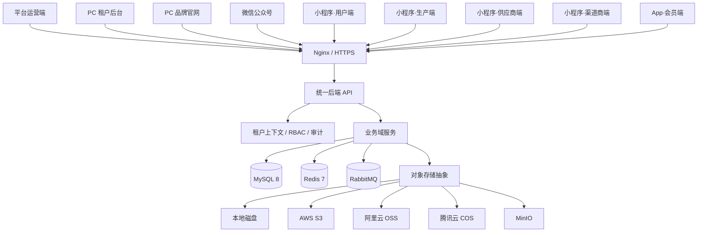

# 婚礼影像数字化多端 SaaS 平台

面向区域连锁婚纱摄影与婚礼影像品牌的数字化经营平台。采用多租户 SaaS 模式，覆盖获客、预约、档期、订单、收款、拍摄、选片、修片、制作、交付、会员、渠道、供应商、员工与经营分析全链路。

项目按一次性完整上线建设，包含平台运营端、PC 租户后台、PC 品牌官网、微信公众号运营、4 个微信小程序、H5 分享页与 Flutter 会员端 App。

- 仓库地址：<https://github.com/quantaida/wedding-photo-platform>
- 默认分支：`main`
- 当前版本：`V1.0`

## 一、项目特色

- 多租户共享库 + `tenant_id` 强制隔离，跨租户访问返回 403 并写安全审计。
- 平台端与租户端账号互斥，平台端只看租户汇总、配额、账单与审计，不暴露业务明细。
- 档期唯一性由服务端强制校验，Redis 分布式锁 + 数据库唯一约束双保险。
- 订单十态状态机，支持改期、取消、加购、返工、超期等异常态。
- 支付回调幂等，重复 `payNo` 只记一次账。
- 客片私有存储，签名 URL 有效期不超过 30 分钟，下载与导出全量审计。
- 对象存储五驱动可切换：本地磁盘、S3、阿里云 OSS、腾讯云 COS、MinIO。
- 公众号、小程序、H5、App 以 UnionID 合并会员身份。
- 金额、比例、提成、佣金、保留期等参数后台可配，历史订单按快照计算。
- 菜单可视化、系统参数可视化、多语言与富文本 CMS。
- 合同 PDF 支持中文，二维码支持 PNG 输出。
- 微信、支付、短信、云存储无凭证时明确报错，不伪造成功。

## 二、端矩阵

| 端 | 入口 | 主要使用者 |
|---|---|---|
| 平台运营端 | `/platform/*` | 平台超管、平台运营、平台财务 |
| PC 品牌官网 | 官网域名 | 访客、会员 |
| PC 租户后台 | `/tenant/*` | 租户管理员、店长、门市、财务、运营、客服、仓管 |
| 微信公众号（服务号） | 微信内 | 粉丝、会员、公众号运营 |
| 小程序·用户端 | 微信小程序 | 会员、客户 |
| H5 分享页 | 微信内或浏览器 | 访客、会员 |
| 小程序·生产端 | 微信小程序 | 摄影师、化妆师、修片师 |
| 小程序·供应商端 | 微信小程序 | 相册、相框、礼服、花艺供应商 |
| 小程序·渠道商端 | 微信小程序 | 酒店、婚庆策划、礼服馆等渠道商 |
| App·会员端 | iOS / Android | 会员、客户 |

平台覆盖 10 个端形态。H5 分享页复用官网与会员会话，不单独计入登录端，因此登录端为 9 个。

## 三、技术栈

| 层级 | 选型 | 版本 |
|---|---|---|
| 后端语言 | Java | 17 LTS |
| 后端框架 | Spring Boot + MyBatis-Plus | 3.2.5 + 3.5.5 |
| 数据库 | MySQL | 8.0.x |
| 缓存 | Redis | 7.x |
| 消息队列 | RabbitMQ | 3.13.x |
| 数据库迁移 | Flyway | 9.x |
| 后台前端 | Vue 3 + Vite + Element Plus | 3.4.x / 5.x / 2.7.x |
| 官网前端 | Vue 3 + Vite | 3.4.x / 5.x |
| 小程序 | 微信原生 | 基础库 3.x |
| App | Flutter | 3.24.x |
| 对象存储 | MinIO 默认，五驱动可切 | RELEASE.2024.x |
| 合同 PDF | OpenPDF | 1.3.39 |
| 二维码 | ZXing | 3.5.3 |
| 反向代理 | Nginx | 1.24 |
| 部署 | Docker Compose | 24.x |
| 监控 | Prometheus + Grafana | 2.52 |

## 四、系统架构



后端为模块化单体，按业务域分包，包边界即模块边界：

- `platform`：平台租户、套餐、配额、账单、公告、平台审计、平台账号。
- `tenant`：租户登录、参数、RBAC、菜单、存储、消息、SSO、审计。
- `biz`：门店、套系、档期、订单、生产、会员、渠道、供应商、员工、内容、报表。
- `mp`：公众号凭证、粉丝、标签、菜单、素材、草稿、回调。
- `open`：官网、小程序、H5、App 公开接口与 UnionID 登录。
- `common`：租户上下文、鉴权、审计、异常、存储、文件校验、编号、加密。

## 五、目录结构

```text
wedding-photo-platform/
├── src/main/java/com/wedding/          # 后端源码
│   ├── platform/                        # 平台运营端域
│   ├── tenant/                          # 租户基础域
│   ├── biz/                             # 业务域
│   ├── mp/                              # 公众号
│   ├── open/                            # 公开 API / 多端入口
│   └── common/                          # 公共能力
├── src/main/resources/
│   ├── application.yml                  # 主配置
│   └── db/migration/                    # Flyway 迁移 V1-V4
├── admin-web/                           # Vue3 管理端（平台端 + 租户端）
├── pc-web/                              # Vue3 品牌官网（SEO）
├── miniprogram/
│   ├── user/                            # 小程序·用户端
│   ├── staff/                           # 小程序·生产端
│   ├── supplier/                        # 小程序·供应商端
│   └── channel/                         # 小程序·渠道商端
├── app/                                 # Flutter 会员端源码
├── deploy/                              # Docker、Nginx、备份、监控
├── docs/
│   ├── adr/                             # 架构决策记录
│   ├── deliverables/                    # T119-T122 Word 交付物
│   ├── test/                            # 回归脚本与报告
│   ├── architecture.md
│   ├── tech-stack.md
│   └── training.md
├── PRO.md                               # 产品需求与业务规则
├── tasks.md                             # T01-T132 任务清单
├── checklist.md                         # 上线验收清单
└── pom.xml
```

## 六、快速开始

### 6.1 环境要求

- JDK 17
- Maven 3.8+
- MySQL 8.0
- Redis 7
- RabbitMQ 3.13
- Node.js 18+（管理端与官网，Vite 5 建议 20+）
- Docker 与 Docker Compose（推荐）
- Flutter 3.24（仅 App 打包需要）

### 6.2 启动基础设施

本地开发默认端口：

| 服务 | 地址 | 说明 |
|---|---|---|
| MySQL | `127.0.0.1:3307` | 库 `wedding_platform` |
| Redis | `127.0.0.1:6380` | 无密码 |
| RabbitMQ | `127.0.0.1:5673` | vhost `/wedding`，管理端 `15673` |

也可以直接使用 Docker Compose 启动全栈：

```bash
cd deploy
cp .env.example .env
# 修改 .env 中的密码与密钥
docker compose up -d
```

### 6.3 启动后端

```bash
export JAVA_HOME=/opt/jdk-17
export PATH=$JAVA_HOME/bin:$PATH

mvn -DskipTests compile
SERVER_PORT=18090 mvn spring-boot:run
```

健康检查：

```bash
curl http://127.0.0.1:18090/actuator/health
# {"status":"UP"}
```

首次启动会自动执行 Flyway 迁移并初始化：

- 平台超管：`admin / admin123`
- 平台财务：`finance / finance123`
- 演示租户：`demo / admin / admin123`

> 以上仅用于本地开发。生产环境必须修改默认口令，并通过环境变量注入数据库、Redis、RabbitMQ、JWT 与 AES 密钥。

### 6.4 启动管理端

```bash
cd admin-web
npm install
npm run dev
```

生产构建：

```bash
npm run build
```

### 6.5 启动官网

```bash
cd pc-web
npm install
npm run dev
npm run build
```

### 6.6 小程序与 App

四个小程序为微信原生独立工程，使用微信开发者工具分别导入：

```text
miniprogram/user
miniprogram/staff
miniprogram/supplier
miniprogram/channel
```

Flutter App 仅包含 Dart 源码。首次使用需生成平台目录：

```bash
cd app
flutter create --platforms=android,ios .
flutter pub get
flutter run
```

## 七、默认入口与账号

| 端 | 地址 / 账号 | 密码 |
|---|---|---|
| 平台运营端 | `http://127.0.0.1:18090` | `admin / admin123` |
| 平台财务 | `http://127.0.0.1:18090` | `finance / finance123` |
| 租户后台 | 租户编码 `demo`，账号 `admin` | `admin123` |
| 接口文档 | `http://127.0.0.1:18090/swagger-ui.html` | - |
| 健康检查 | `http://127.0.0.1:18090/actuator/health` | - |

## 八、核心配置

主要环境变量见 `deploy/.env.example`：

| 变量 | 说明 |
|---|---|
| `SERVER_PORT` | 应用端口，默认 8080 |
| `MYSQL_HOST` / `MYSQL_PORT` / `MYSQL_DB` | 数据库连接 |
| `MYSQL_USER` / `MYSQL_PASSWORD` | 数据库账号 |
| `REDIS_HOST` / `REDIS_PORT` / `REDIS_PASSWORD` | Redis 连接 |
| `RABBIT_HOST` / `RABBIT_PORT` / `RABBIT_VHOST` | RabbitMQ 连接 |
| `JWT_SECRET` | JWT 签名密钥，生产不少于 48 字符 |
| `AES_KEY` | 敏感配置加密密钥，32 字节 |
| `STORAGE_LOCAL_ROOT` | 本地存储根目录 |
| `MP_CALLBACK_BASE` | 公众号回调地址前缀 |

敏感配置包括公众号 AppSecret、对象存储 AK/SK、SSO Secret、短信与支付密钥，均以 AES 加密存储，页面只显示掩码。

## 九、测试

回归脚本：

```bash
python3 docs/test/regression.py
```

覆盖 23 项接口级用例：

- 平台与租户登录、租户开通
- 通用 CRUD、订单创建
- 跨租户 403、平台与租户互斥
- 支付回调幂等
- 20 并发抢同一档期仅 1 单成功
- 报表异步导出与签名下载
- 合同中文 PDF、多端入口二维码
- 伪装图片上传拦截
- SQL 注入无效
- UnionID 多端同一会员
- 审计只读与平台端数据边界

结果输出：

- `docs/test/regression-result.json`
- `docs/test/regression-report.md`

当前本地回归结果：**23 / 23 通过**。

## 十、部署

部署材料位于 `deploy/`：

```text
deploy/
├── Dockerfile
├── docker-compose.yml
├── .env.example
├── nginx/
│   ├── nginx.conf
│   └── conf.d/wedding.conf
├── backup/
│   ├── backup.sh
│   ├── restore.sh
│   └── README.md
└── monitoring/
    ├── prometheus.yml
    ├── alerts.yml
    └── README.md
```

部署前必须完成：

1. 修改 `.env` 中全部默认密码与密钥。
2. 配置 HTTPS 证书与租户子域名。
3. 执行数据库备份与恢复演练。
4. 验证对象存储连通性与私有桶策略。
5. 按 `checklist.md` 完成上线检查。

## 十一、交付文档

| 文档 | 路径 |
|---|---|
| 需求规格说明书 | `docs/deliverables/T119-需求规格说明书.docx` |
| 技术方案与开发报价 | `docs/deliverables/T120-技术方案与开发报价.docx` |
| 用户使用手册 | `docs/deliverables/T121-用户使用手册.docx` |
| 三份文档一致性自检报告 | `docs/deliverables/T122-三份文档一致性自检报告.docx` |
| 架构说明 | `docs/architecture.md` |
| 技术栈唯一事实源 | `docs/tech-stack.md` |
| 培训材料 | `docs/training.md` |
| 上线验收清单 | `checklist.md` |
| 开发任务清单 | `tasks.md` |

## 十二、已知限制

以下能力已完成代码与本地模拟，但需在正式凭证或目标环境补齐验证：

1. 微信真实凭证、模板消息到达、公众号菜单发布、素材与草稿发表。
2. 微信支付、支付宝真实扣款与退款回调；当前以线下收款和模拟回调验证幂等。
3. 短信真实发送；未启用渠道时按设计降级写日志。
4. S3、OSS、COS、MinIO 真实连通性；本地驱动已实测。
5. Flutter App 打包、真机安装与上架材料。
6. 2000 张客片批量上传压测、100 并发档期压测、容器编排全栈演练、备份恢复演练。
7. 管理员与一线角色培训、两周试运行及四方验收签字。

## 十三、安全说明

- 生产环境禁止使用仓库中的默认口令。
- `.env`、密钥、证书与运行数据不得提交到仓库，`.gitignore` 已默认排除。
- 客片属于客户隐私资产，禁止在公开环境使用真实客片做演示。
- 发现安全问题请通过仓库 Issue 或项目联系人私下反馈，不要公开披露客户数据。

## 十四、许可证

本项目为商业交付项目，源码与文档版权归委托方与开发方共同约定所有。未经授权，不得复制、分发或用于其他商业项目。
