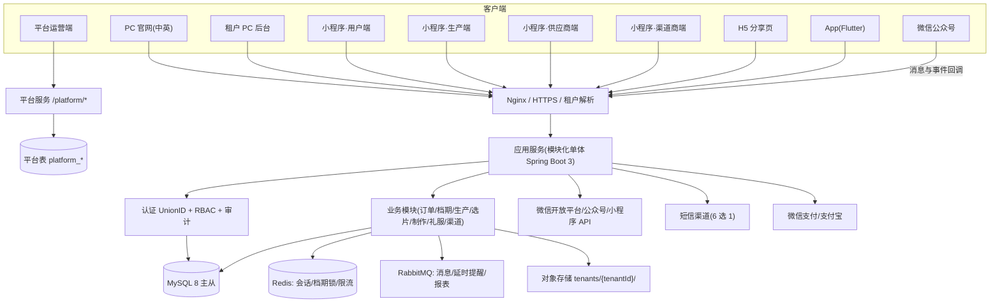
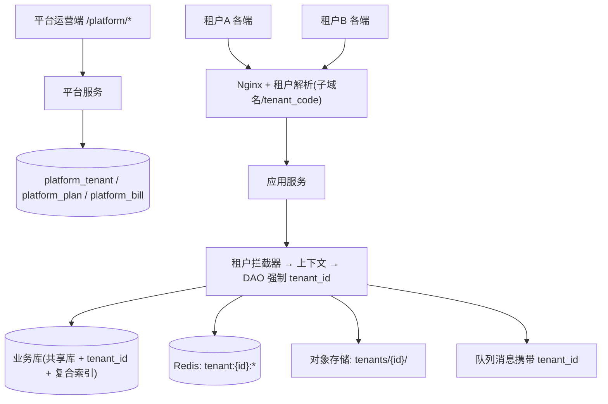

# 系统架构

> 本文与 `PRO.md` 第一章逐条对齐，是研发、部署、验收的共同基线。

## 1. 架构总览

平台采用“一后端多前端壳”：Spring Boot 3 模块化单体提供统一 API、认证、权限、审计、租户隔离、UnionID 会员与对象存储能力；9 个端只承担展示与角色差异。

### 1.1 一后端多前端壳



### 1.2 多租户链路



## 2. 代码结构与模块边界

```
src/main/java/com/wedding
├── common/          通用能力：R/PageResult、异常、JWT、租户上下文、审计切面、存储抽象、AES
├── platform/        平台运营端：租户、套餐、账单、公告、审计、平台账号
├── tenant/          租户后台基础：认证、RBAC、参数、菜单、存储配置、系统配置、工作台、通用 CRUD
├── biz/
│   ├── order/       订单状态机、支付、退款、合同
│   ├── schedule/    档期资源、日历、锁档、释放
│   ├── production/  拍摄、打卡、分片上传、选片、修图、制作、交付、礼服
│   ├── crm/         线索、会员、积分、储值、优惠券
│   ├── channel/     渠道、报单、佣金、结算、门户
│   ├── supplier/    供应商、制作单协同、对账、资质
│   ├── employee/    排班、提成规则、业绩、生产端任务
│   ├── report/      9 类指标、异步导出
│   ├── entry/       多端入口与二维码
│   ├── mp/          公众号账号、同步、菜单、素材、草稿
│   └── cms/         客片授权、文章、留资、站内信、直播相册
├── open/            公开 API：官网、会员、支付回调、公众号回调、存储签名
├── job/             Rabbit 消费者与定时任务
└── config/          安全、Web、Rabbit、MyBatis-Plus 配置
```

约束：

- 跨域调用只允许通过 Service 接口，不直接访问其他域的 Mapper。
- 通用标准表走 `GenericCrudService`（表/列白名单），强流程走专用 Service。
- 业务表必须含 `tenant_id`；平台表以 `platform_` 前缀命名，被租户拦截器忽略。

## 3. 多租户隔离实现

1. 登录返回 JWT，载荷含 `tenantId`、`userId`、`userType`、`dataScope`。
2. `TenantContextFilter` 解析 Token 后写入 `TenantContext` 与 `LoginContext`。
3. MyBatis-Plus 租户拦截器对业务表自动追加 `tenant_id = ?`；`platform_*` 表排除。
4. 所有按 ID 查询的 Service 在 SQL 中显式带 `tenant_id`，防绕过；跨租户访问抛 403 并写安全审计。
5. Redis key 统一 `tenant:{id}:*`，对象存储路径统一 `tenants/{id}/`，队列消息体携带 `tenantId`。
6. 平台端只访问 `platform_*` 与汇总视图，不提供租户业务明细接口。

## 4. 关键链路

### 4.1 锁档与下单

```
选择资源/时段 → Redis SETNX(tenant:{id}:slot:...) 30min
  → DB sch_slot 唯一索引兜底
  → 事务内二次校验 used_count < capacity
  → 创建 order_main + 锁档记录
  → 未付定金：Rabbit 延时消息 + 每分钟兜底任务释放
```

三道防线保证并发下不超卖；释放后他人可正常下单。

### 4.2 支付与退款

- 支付回调以 `payNo` 为幂等键，重复通知只记一次账。
- 回调丢失时主动查单补偿；每日对账日结。
- 退款先申请、后审核，审核与打款全量审计。

### 4.3 客片上传与交付

- 分片上传：init（MD5 秒传）→ chunk → complete。
- 文件落 `tenants/{id}/orders/{orderNo}/{raw|retouched|print}/`。
- 私有桶 + 签名 URL（≤30 分钟）；后台预览强制水印。
- 保留期默认 90 天，到期提醒、可延期一次，清理任务留审计。

### 4.4 异步任务

| 队列 | 用途 |
|---|---|
| `msg.notify` | 短信、模板消息、站内信 |
| `report.async` | 报表 CSV 生成与对象存储上传 |
| `mp.event` | 公众号事件落库与业务处理 |
| `task.delay.dlq` | 锁档、尾款、交付提醒等延时消息死信 |

## 5. 非功能落地

| 维度 | 落地方式 |
|---|---|
| 并发 | 应用无状态可横向扩容；档期锁与唯一索引；连接池 50 |
| 响应 | 列表分页、索引覆盖、报表异步、静态资源 CDN/缓存 |
| 可用性 | Nginx 健康检查、Compose 重启策略、每日备份、恢复演练 |
| 安全 | HTTPS、JWT、RBAC、AES 密钥、签名 URL、上传白名单、限流 |
| 可维护 | 金额/比例/时长/保留期全部走系统参数，不写死 |
| 可观测 | Actuator 健康与指标、结构化日志、审计表、Prometheus 告警 |

## 6. 部署拓扑

```
Internet
  ├── wedding.example.com      → Nginx → pc-web dist
  ├── admin.wedding.example.com→ Nginx → admin-web dist
  └── api.wedding.example.com  → Nginx → app:8080
                                        ├── MySQL 8
                                        ├── Redis 7
                                        ├── RabbitMQ 3.13
                                        └── MinIO / 云对象存储
```

详见 `deploy/README.md`。
